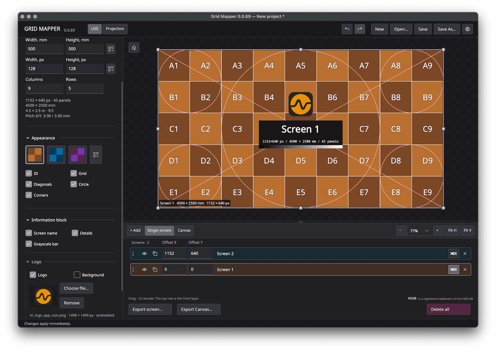
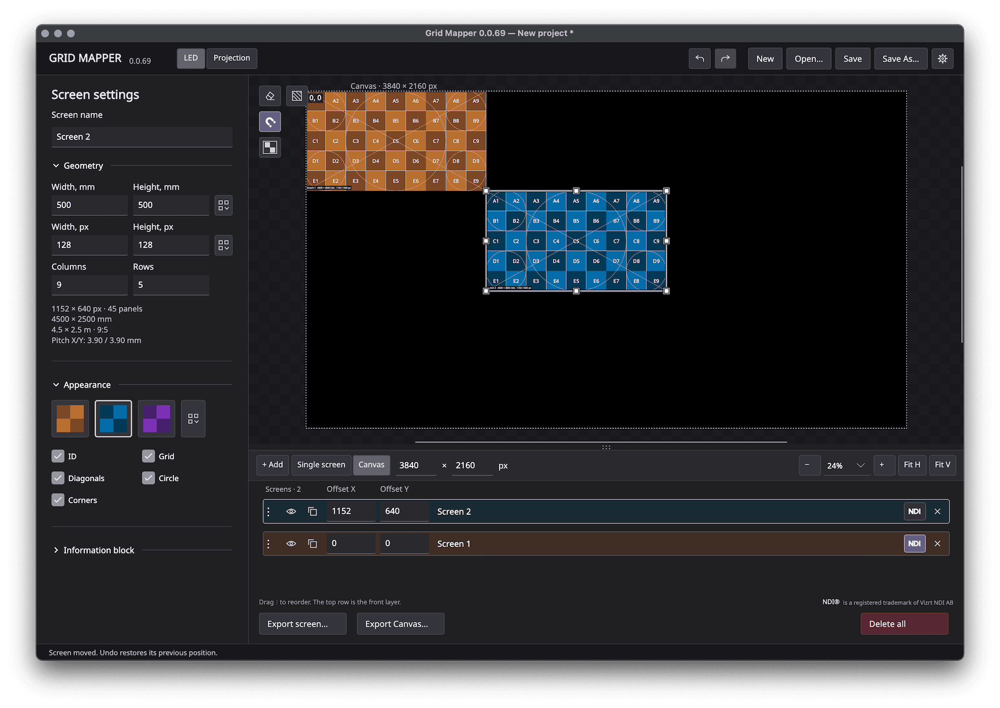
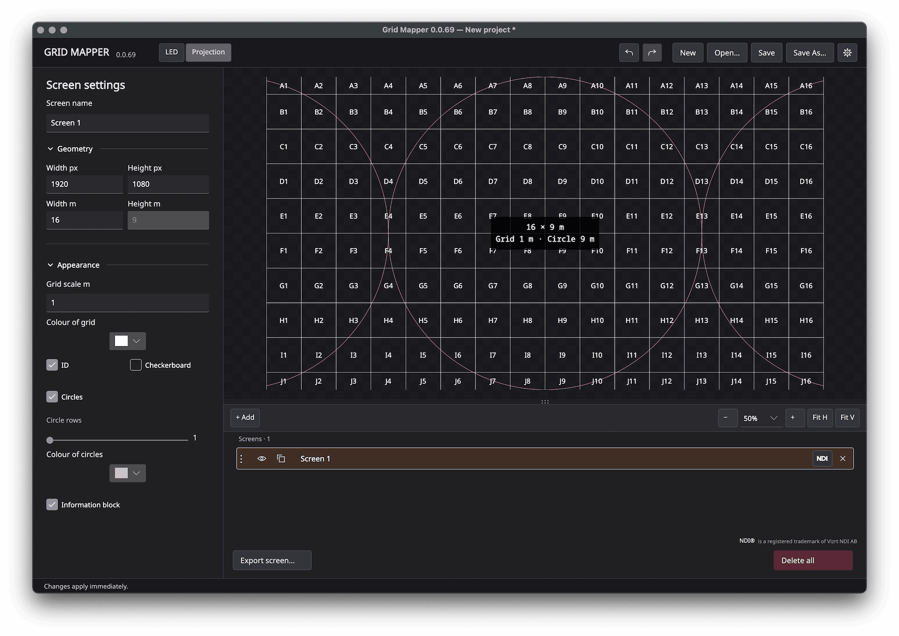

# Grid Mapper

[Русская версия](README_RU.md)

**Grid Mapper** is a test pattern generator for **LED screens and video projection**.
It runs on Windows x64 and macOS Apple Silicon without an internet connection.
Export patterns as PNG images or send an independent NDI output for each screen
at 50 or 60 frames per second.

Grid Mapper helps verify geometry, scale, panel layout and image proportions
when setting up LED screens and projectors.

## Download v.0.1.1

- [Windows installer](https://github.com/viavisionpro/Grid-Mapper/releases/latest/download/GridMapper-v0.1.1-Windows-x64-Setup.exe)
- [Windows portable ZIP](https://github.com/viavisionpro/Grid-Mapper/releases/latest/download/GridMapper-v0.1.1-Windows-x64-Portable.zip)
- [macOS Apple Silicon DMG](https://github.com/viavisionpro/Grid-Mapper/releases/latest/download/GridMapper-v0.1.1-macOS-AppleSilicon.dmg) · [ZIP](https://github.com/viavisionpro/Grid-Mapper/releases/latest/download/GridMapper-v0.1.1-macOS-AppleSilicon.zip)

macOS first launch requires a one-time approval in **System Settings → Privacy & Security → Open Anyway**. This release is not notarized. See the [installation guide](docs/user/README.md#install-and-remove).

## Features

- LED panel dimensions in millimetres and pixels, with size and pixel pitch presets.
- Colour profiles, checkerboard fills, grids, panel IDs, diagonals and reference circles.
- Multiple screens on a shared Canvas, with snapping, layer ordering and precise positioning.
- Individual panel masking and a reference image overlay for custom screen layouts.
- An information block with screen name, dimensions, resolution, logo and grayscale bar.
- PNG export for individual screens or the Canvas, with transparency support.
- Resolume Arena Advanced Output XML export from Canvas.
- Independent NDI outputs, project saving, undo/redo and arithmetic in numeric fields.
- English and Russian interfaces, with support for user-created translations.

## Two modes

**LED** — generate patterns using panel dimensions and pixel resolution. Work
with a single screen or arrange multiple screens on a shared Canvas.

**Projection** — generate patterns using output resolution and physical width.
A metric grid, reference circles and a border with metre and decimetre marks
help verify projection scale and geometry.

LED and Projection keep separate screen collections within the same `.gpm` project.

## Screenshots

### LED pattern

### Canvas

### Projection

## Quick start

1. Download a package above. On Windows, run Setup or extract the entire portable
   ZIP and launch **GridMapper.Desktop.exe**. On macOS 14 or later with Apple
   Silicon, open the DMG and drag **Grid Mapper** to **Applications**.
2. Choose **LED** or **Projection**, add a screen and enter its dimensions.
   Parameters apply as you type; **Enter** or **Tab** evaluates arithmetic.
3. Use the wheel or pinch gesture to zoom; middle-drag or **Space + left-drag**
   pans the workspace. **Fit H / Fit V** fit the image horizontally/vertically.
4. Save the project as `.gpm`, export PNG/XML, or enable the screen's **NDI** button.

NDI requires a separately installed compatible NDI Runtime. It is not bundled;
PNG export and editing work offline. Set NDI frame rate and interface language
in **Settings**.

For all controls, installation/removal and NDI library updates, see the
[English manual](docs/user/README.md) or [Russian manual](docs/user/README.ru.md).
Build instructions are in [BUILDING.md](BUILDING.md).

## License

[GNU GPL v3 only](LICENSE) · Copyright © 2026 VIAVISION · [viavision.pro](https://viavision.pro)

Third-party components retain their licenses; see
[notices](THIRD_PARTY_NOTICES.md) and the `Licenses` folder in each package.
NDI® is a registered trademark of Vizrt NDI AB.
